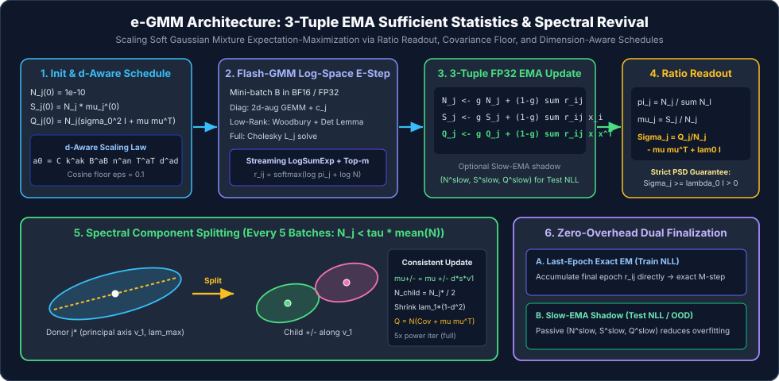

# e_GMM-scaling

**`e-GMM`: Scaling Expectation-Maximization to Billion-Scale Datasets via Exponential Moving Averages** — extending Meta FAIR's [`e-means`](https://arxiv.org/abs/2611.09501) primitives to Gaussian Mixture Models via **3-tuple EMA sufficient statistics $(N_j, S_j, Q_j)$**, a **covariance floor $\lambda_0 I_d$**, **Flash-GMM single-GEMM E-step reformulation**, **low-rank + diagonal Woodbury scaling**, **dimension-aware power-law schedules $\alpha_0(k, B, n, T, d)$**, and **spectral donor splitting along $\mathbf{v}_1$**.

> **Offline & Safe Setup**: Nothing in this repository automatically downloads external billion-scale datasets (`SIFT1M`, `DEEP1B`, `DINOv2-100M`, `ImageNet-1k`) or launches multi-GPU jobs. All architectural/memory profilers, mathematical proofs, scaling-law verifications, and synthetic anisotropic/Zipf-GMM benchmarks execute locally out of the box using pure NumPy.

---

## Repository Map

| Folder / File | Purpose |
| :--- | :--- |
| [**`docs/basic-terms/`**](./docs/basic-terms/00-INDEX.md) | Structured Markdown primers covering 3-tuple EMA $(N_j, S_j, Q_j)$, Cappé & Moulines (2009) Online EM bottlenecks, diagonal/low-rank Woodbury/full covariances, Flash-GMM GEMM E-step, spectral splitting along $\mathbf{v}_1$, dimension-aware scaling laws, and A–Z glossary |
| [**`docs/architecture/`**](./docs/architecture/IMPLEMENTATION-PLAN-EGMM.md) | Full `e-GMM` systems blueprint: Triton/PyTorch Flash-GMM kernel spec, Cholesky/log-det stability, memory/FLOP scaling tables, and Phase A–C (`200–300 GPU-hrs`) experimental roadmap |
| [**`docs/assets/images/`**](./docs/assets/images/) | Vector SVG architecture diagrams (`egmm-3tuple-pipeline.svg`, `flash-gmm-gemm-reformulation.svg`, `spectral-splitting-geometry.svg`, `covariance-parametrizations-memory.svg`) |
| **`src/e_gmm/`** | Core modules: `config.py`, `schedule.py`, `metrics.py`, `scaling_law.py`, `datasets.py`, `numpy_egmm.py`, `torch_egmm.py`, `triton_kernels.py`, `poc_logging.py` |
| **`scripts/`** | Zero-download profiler (`explore_egmm_memory_and_flops.py`), NumPy mathematical verification & benchmark (`mini_run_math_verify.py`), dimension-aware scaling-law sweep planner (`plan_scaling_sweep.py`), and PyTorch Flash-GMM validator (`mini_run_torch_flash_gmm.py`) |
| **`configs/`** | Ready JSON specs for `tiny_egmm_debug`, `sift1m_diag_k4096`, `deep1b_diag_k65536`, `dinov2_100m_lowrank_k16384`, `imagenet1k_full_k1024`, and `phase_a_scaling_manifest` |
| [**`poc/`**](./poc/README.md) | 4-Tier Proof-of-Concept suite + result compiler & compute proposal template (`poc_01`..`poc_04` + `compile_poc_report.py`) |
| **`tests/`** | Automated NumPy mathematical unit tests & PyTorch Flash-GMM / Woodbury / spectral-split tests |

---

## Visual Architecture: 3-Tuple EMA & Spectral Component Splitting



---

## Quick Start (Runs Immediately Without Downloads or GPUs)

```bash
# 1. Profile Diagonal vs Low-Rank+Diag vs Full Covariance VRAM (275 GB wall!) & Flash-GMM FLOPs
python scripts/explore_egmm_memory_and_flops.py

# 2. Prove PSD floor, Flash-GMM GEMM equivalence, Woodbury identity & spectral split consistency
python scripts/mini_run_math_verify.py

# 3. Generate Phase-A dimension-aware scaling sweep manifest & verify OLS + LOSO/LODO fitter
python scripts/plan_scaling_sweep.py

# 4. Run preliminary diagnostics & baseline comparison readiness audit
python scripts/run_preliminary_diagnostics.py

# 5. Run offline mathematical & diagnostic unit tests (pure NumPy)
python -m unittest discover -s tests -v

# 5. Run offline Proof-of-Concept suite (PoC 1-3) & compile COMPILED-POC-REPORT.md
python poc/poc_01_math_and_profiler.py
python poc/poc_02_collapse_and_spectral_split.py
python poc/poc_03_dimension_scaling_law.py
python poc/compile_poc_report.py
```

### Cluster / PyTorch Dry-Run (On a Machine with `torch` Installed)

```bash
# Verify Flash-GMM tiled 2d-GEMM E-step, Woodbury low-rank+diag, Top-m sparsity, and spectral split
python scripts/mini_run_torch_flash_gmm.py
python poc/poc_04_flash_gmm_and_lowrank.py
pytest tests/
```
