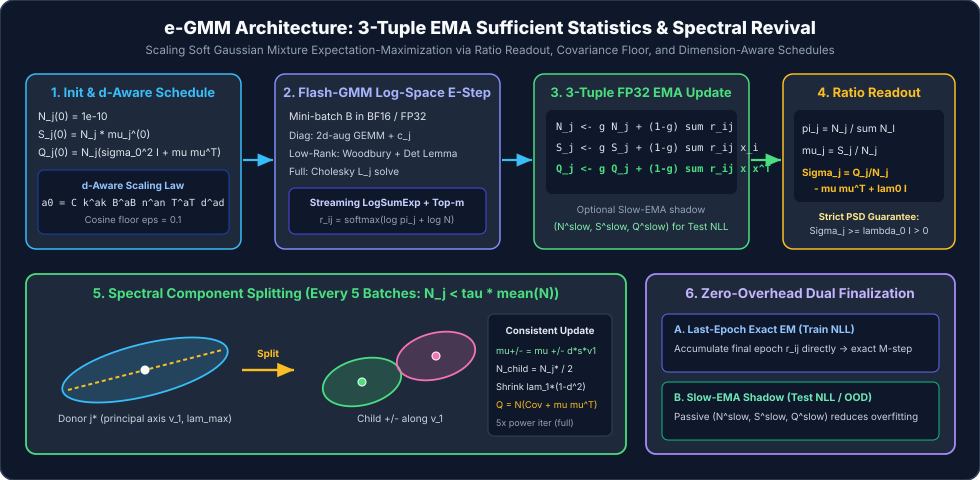
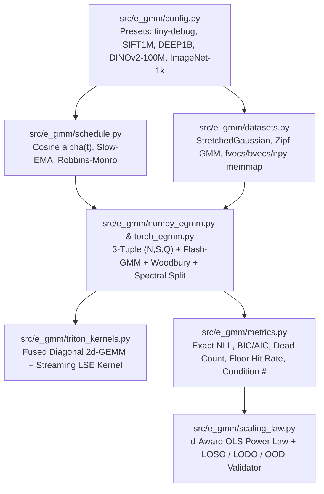

# `e-GMM`: Systems Architecture & Full Implementation Plan

**Target Paper Title**: *"e-GMM: Scaling Expectation-Maximization to Billion-Scale Datasets via Exponential Moving Averages"*  
**Track Status**: **Tier 1 (Highest Novelty — Cleanest Theory & Best Compute ROI)**  
**Target Compute Budget**: **200–300 GPU-hours** on **1× to 2× NVIDIA A100 / H100 (80 GB)** (~1.5–2 weeks on 1 GPU)

> **Safe Offline Execution**: Nothing in this repo downloads `SIFT`, `DEEP1B`, `DINOv2-100M`, or `ImageNet-1k` automatically. All memory/FLOP audits, math proofs, synthetic benchmarks, and scaling-law tests run offline immediately via `numpy`, and PyTorch/Triton kernels run cleanly when a GPU environment is attached.

---

## 1. Visual Architecture

---

## 2. Software Architecture (`src/e_gmm/`)

---

## 3. Target Benchmarks & Memory/Compute Footprint

Run `python scripts/explore_egmm_memory_and_flops.py` to audit exact FP32 accumulator memory, E-step FLOPs, and Flash-GMM HBM savings across all presets:

| Preset | $n$ | $d$ | $k$ | Cov Mode | 3-Tuple State (FP32) | Naive $B \times k$ HBM ($B=65\text{k}$) | Flash-GMM Tiled HBM |
| :--- | :---: | :---: | :---: | :--- | :---: | :---: | :---: |
| `tiny-debug` | $10^4$ | 32 | 16 | `full` / `diag` | `< 1 MB` | `< 5 MB` | `< 1 MB` |
| `imagenet-1k` | $1.28\text{M}$ | 768 | 1,024 | `full` | `2.42 GB` | `0.26 GB` | `< 10 MB` |
| `sift-1m` | $10^6$ | 128 | 4,096 | `diag` | `4.2 MB` | `1.07 GB` | `< 16 MB` |
| `dinov2-100m` | $10^8$ | 1,024 | 16,384 | `low_rank_diag` ($r=16$) | `1.21 GB` | `4.29 GB` | `< 32 MB` |
| `deep-1b` | $10^9$ | 96 | 65,536 | `diag` | `50.6 MB` | `17.18 GB` | `< 32 MB` |
| *(Full Wall Ref)* | $10^9$ | 1,024 | 65,536 | `full` | **`275.4 GB` (OOM!)** | `17.18 GB` | — |

---

## 4. Phased Experimental & Execution Plan (200–300 GPU-Hours)

### Phase 0: Local Offline Verification *(Runnable Right Now — \$0, CPU)*
1. `python scripts/explore_egmm_memory_and_flops.py` — Prints the $O(kd)$ vs. $O(kdr)$ vs. $O(kd^2)$ 275 GB wall and Flash-GMM HBM compression.
2. `python scripts/mini_run_math_verify.py` — Numerically verifies:
   - $\Sigma_j \succeq \lambda_0 I_d \succ 0$ positive-definiteness across extreme under-populated batches.
   - Flash-GMM $2d$-augmented GEMM equivalence ($\max |\Delta \ln \mathcal{N}| < 10^{-11}$ in FP64).
   - Woodbury inverse + Matrix Determinant Lemma equivalence against dense $d \times d$ solve.
   - Spectral split second-moment conservation ($Q_{\text{child}}/N_{\text{child}} - \mu_{\text{child}}\mu_{\text{child}}^\top = \Sigma_{\text{child}}$).
   - Multi-method benchmark on Stretched-Gaussian & Zipf-GMM (`FullBatchEM`, `OnlineEM (Cappé-Moulines)`, `e-means + PostHoc`, `e-GMM No Revival`, `e-GMM Spectral Split`).
3. `python scripts/plan_scaling_sweep.py` — Generates `configs/phase_a_scaling_manifest.json` and verifies OLS + LOSO-$n$ + LODO-$d$ recovery.
4. `python -m unittest discover -s tests -p "*numpy*.py" -v` — Runs the complete pure-NumPy test suite.

### Phase A: Dimension-Aware Scaling-Law Sweeps *(~80 GPU-hours)*
1. Sweep $(n, k, d, B, T)$ on `DEEP` + `StretchedGaussian` across $d \in \{32, 96, 256, 768\}$, $k \in [64, 16384]$, $n \in [10^5, 10^8]$.
2. Fit both $\alpha_0(k, B, n, T, d)$ and knee batch size $B_{\text{knee}}(k, n, T, d)$ in log-space OLS.
3. Validate **held-out NLL regret** under:
   - **LOSO** (leave-one-$n$-out),
   - **LODO** (leave-one-$d$-out),
   - **OOD** transfer (`SIFT`, `SPACEV`, `ImageNet-1k`).
4. Confirm quantitatively that $d^{a_d}$ stabilizes NLL scaling where ambient $d$ was unstable for MSE.

### Phase B: Billion-Scale Vector & Vision Benchmarks *(~120 GPU-hours)*
- **Datasets**: `SIFT1M` ($d=128$), `DEEP1B` ($d=96$), `DINOv2-100M` ($d=1024$), `ImageNet-1k` embeddings ($d=768$) across $k \in [64, 65536]$.
- **Controlled Baselines**:
  1. **Full-Batch EM** (`scikit-learn` up to 1M / custom GPU full-batch EM).
  2. **Online / Stochastic EM (Cappé & Moulines, 2009)** with swept Robbins-Monro $(\beta, t_0)$.
  3. **`e-means` + Post-Hoc Covariance Fit** (critical baseline proving joint soft EM in `e-GMM` beats hard `e-means` + 1 post-hoc M-step!).
- **Metrics**: Held-out Test NLL, Train NLL, BIC/AIC, epochs & wall-clock seconds to target NLL, collapsed-Gaussian rate ($N_j < \tau\bar{N}$), and covariance floor-hit / Cholesky failure rate.

### Phase C: Systematic Ablations *(~50 GPU-hours)*
1. **Revival Policy**: Spectral splitting along $\mathbf{v}_1$ vs. random orthogonal split vs. Faiss alternating $\pm \delta$ split vs. batch resampling vs. no revival.
2. **Covariance Structure & Floor**: $\lambda_0 \in \{10^{-6}, 10^{-4}, 10^{-2}\}$ sensitivity + Diagonal vs. Low-Rank+Diag ($r \in \{4, 8, 16, 32\}$) vs. Full covariance.
3. **E-Step Sparsity**: Top-$m$ sparse truncation ($m \in \{4, 8, 16, 32\}$) vs. exact dense softmax responsibilities.
4. **Finalization**: Last-Epoch Exact EM (optimizes Train NLL) vs. Slow-EMA Shadow (optimizes Test NLL / OOD).

---

## 5. Risk Mitigations Built Into the Codebase

| Risk | Mitigation in `e_GMM-scaling` |
| :--- | :--- |
| **Log-Space Softmax Underflow** | Always compute $\ln \pi_j + \ln \mathcal{N}(x_i \mid \mu_j, \Sigma_j)$ in FP32 with online max-shifted `logsumexp`. |
| **Catastrophic Cancellation in $Q_j/N_j - \mu_j\mu_j^\top$** | Keep $(N_j, S_j, Q_j)$ strictly in FP32 (or FP64); apply `.clamp_min(cov_floor)` / `+ lambda_0 I_d` after subtraction. |
| **Cholesky Failure on Ill-Conditioned Full $\Sigma_j$** | Symmetrize $\frac{1}{2}(\Sigma_j + \Sigma_j^\top)$, enforce $\lambda_0 I_d$, and use `cholesky_ex` with adaptive jitter escalation. |
| **Large-$B \times k$ HBM OOM** | Use tiled streaming `logsumexp` + Top-$m$ sparse index accumulation (`chunk_k`, `chunk_b`). |
