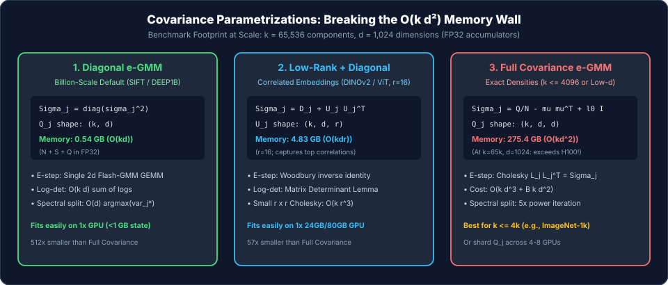

# 03. Covariance Parametrizations, Woodbury Identity & Numerical Stability

To scale `e-GMM` from low-dimensional density estimation ($d \le 128, k \le 4096$) all the way to billion-scale foundation embeddings ($d = 1024, k = 65{,}536$), `e_GMM-scaling` supports **three covariance modes** sharing the same 3-tuple EMA discipline.

---

## 1. Summary of Covariance Modes

| Mode (`cov_type`) | Covariance Form $\Sigma_j$ | State Memory | E-Step Complexity (per batch $B$) | Best Use Case |
| :--- | :--- | :---: | :---: | :--- |
| **`"diag"`** | $\text{diag}(\sigma_j^2) \succeq \lambda_0 I_d$ | $O(kd)$ | $O(Bkd)$ (Single $2d$ GEMM!) | Billion-scale ANNS/embeddings (`SIFT`, `DEEP1B`) |
| **`"low_rank_diag"`** | $D_j + U_j U_j^\top$, $D_j = \text{diag}(d_j)$, $U_j \in \mathbb{R}^{d \times r}$ | $O(kdr)$ | $O(Bkr + Bkd + kr^3)$ (Woodbury) | Correlated ViT/LLM embeddings (`DINOv2`, `CLIP`) |
| **`"full"`** | $\frac{Q_j}{N_j} - \mu_j\mu_j^\top + \lambda_0 I_d \in \mathbb{R}^{d \times d}$ | $O(kd^2)$ | $O(kd^3 + Bkd^2)$ (Cholesky) | Exact full-covariance density (`ImageNet-1k`, low $d/k$) |

At $k = 65{,}536, d = 1024$ (FP32 accumulators):
- **Diagonal**: `0.54 GB` (fits effortlessly on any GPU)
- **Low-Rank + Diag ($r = 16$)**: `4.83 GB` (fits on a single RTX 4090 / A100)
- **Full Covariance**: `275.4 GB` (**exceeds an entire 80 GB H100 by $3.4\times$**)

---

## 2. Low-Rank + Diagonal via Woodbury & Matrix Determinant Lemma

When real vision/language embeddings exhibit strong off-diagonal correlations along a $r$-dimensional local subspace ($r \ll d$, e.g., $r = 16$ vs. $d = 1024$), modeling $\Sigma_j = D_j + U_j U_j^\top$ captures the top-$r$ principal directions while remaining linear in $d$!

### A. Exact Inverse via Woodbury Matrix Identity
Let $\Delta_i = x_i - \mu_j \in \mathbb{R}^d$, $D_j = \text{diag}(d_j)$ with $d_{jm} \ge \lambda_0 > 0$, and $U_j \in \mathbb{R}^{d \times r}$. Define the $r \times r$ capacitance matrix:
$$
C_j = I_r + U_j^\top D_j^{-1} U_j \in \mathbb{R}^{r \times r}
$$
Since $D_j \succ 0$, $C_j$ is strictly symmetric positive-definite ($C_j \succeq I_r$) with condition number far smaller than $\Sigma_j$. By the **Woodbury identity**:
$$
\Sigma_j^{-1} = (D_j + U_j U_j^\top)^{-1} = D_j^{-1} - D_j^{-1} U_j C_j^{-1} U_j^\top D_j^{-1}
$$
Therefore, the **Mahalanobis quadratic form** never materializes a $d \times d$ matrix:
$$
\Delta_i^\top \Sigma_j^{-1} \Delta_i = \underbrace{\sum_{m=1}^d \frac{\Delta_{im}^2}{d_{jm}}}_{\text{diag term } O(Bkd)} - \underbrace{\left\| L_{C,j}^{-1} \big( U_j^\top D_j^{-1} \Delta_i \big) \right\|_2^2}_{\text{rank-}r \text{ correction } O(Bkr + Bkd)}
$$
where $C_j = L_{C,j} L_{C,j}^\top$ is a tiny $r \times r$ Cholesky factorization ($O(kr^3)$, instantaneous for $r=16$)!

### B. Exact Log-Determinant via Matrix Determinant Lemma
$$
\ln \det(D_j + U_j U_j^\top) = \sum_{m=1}^{d} \ln d_{jm} + \ln \det\left(I_r + U_j^\top D_j^{-1} U_j\right) = \sum_{m=1}^{d} \ln d_{jm} + 2 \sum_{q=1}^{r} \ln (L_{C,j})_{qq}
$$

### C. Maintaining $(D_j, U_j)$ From 3-Tuple EMA Moments
How do we extract $(D_j, U_j)$ without storing $(k, d, d)$?
- **Exact Small-$d$ / Hybrid Mode**: Maintain $Q_j \in \mathbb{R}^{k \times d \times d}$ when $d \le 256$ or sharded, and extract top-$r$ eigenpairs via subspace iteration, setting $D_j = \max(\text{diag}(\Sigma_j) - \text{diag}(U_j U_j^\top), \lambda_0)$.
- **Streaming Oja / Frequent-Directions Factor Mode ($O(kdr)$ memory)**: Track diagonal second moment $Q_j^{\text{diag}} \in \mathbb{R}^{k \times d}$ plus an EMA rank-$r$ subspace $F_j \in \mathbb{R}^{k \times d \times r}$ updated from batch residuals $(x_i - \mu_j)$ weighted by $r_{ij}$, keeping memory strictly $O(kdr)$! Both forms share the exact same Woodbury E-step kernel.

---

## 3. Full Covariance Mode & Adaptive Cholesky Stability

For `cov_type="full"`, readout produces $\Sigma_j = \frac{Q_j}{N_j} - \mu_j \mu_j^\top + \lambda_0 I_d$.
1. **Symmetrization**: Enforce $\Sigma_j \leftarrow \frac{1}{2}(\Sigma_j + \Sigma_j^\top)$ to eliminate floating-point asymmetry.
2. **Cholesky Factorization**: Factor $\Sigma_j = L_j L_j^\top$. Then:
   - $\ln \det \Sigma_j = 2 \sum_{m=1}^{d} \ln (L_j)_{mm}$
   - $\Delta^\top \Sigma_j^{-1} \Delta = \|L_j^{-1} \Delta\|_2^2$ via triangular solve (`solve_triangular`).
3. **Adaptive Jitter Safeguard**: Even with $\lambda_0 I_d$, extreme scale disparities ($\|\mu_j\|^2 \gg \lambda_0$) in FP32 can cause numerical non-PSD. `torch.linalg.cholesky_ex` (or NumPy fallback) retries with geometrically increasing jitter $\{10^{-6}, 10^{-5}, 10^{-4}, 10^{-3}\} \cdot \text{tr}(\Sigma_j)/d$—while logging `chol_fallback_count` as a diagnostic metric!

---

## 4. Sources & References
- **Woodbury (1950)** / **Hager (1989)**: *Updating the inverse of a matrix*, SIAM Review.
- **Tipping & Bishop (1999)**: *Mixtures of Probabilistic Principal Component Analyzers* (MPPCA — closely related low-rank+isotropic model).
- **Bishop (2006)**: *PRML*, Appendix C (Matrix Identities).
