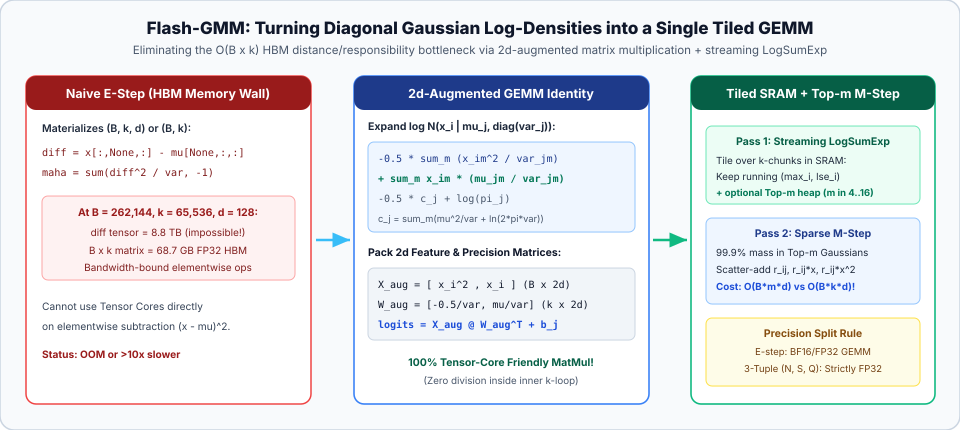

# 04. Flash-GMM Kernels, Precision Splitting & Top-$m$ Sparse Responsibilities

In `e-means`, custom tiled kernels (`CuTe DSL` / `Flash-KMeans`) avoid materializing the $B \times k$ distance matrix in GPU HBM and cast assignments to Tensor Core GEMMs via $\|c_j\|^2 - 2 x_i^\top c_j$. This document derives the exact **Flash-GMM** generalization for Gaussian log-densities.

---

## 1. Exact Algebraic Reduction to a Single $2d$-Augmented GEMM

For diagonal covariance $\Sigma_j = \text{diag}(\sigma_{j1}^2, \dots, \sigma_{jd}^2)$ with $\sigma_{jm}^2 \ge \lambda_0 > 0$, the Gaussian log-density of vector $x_i \in \mathbb{R}^d$ under component $j$ is:

$$
\ln \mathcal{N}(x_i \mid \mu_j, \Sigma_j) = -\frac{1}{2} \sum_{m=1}^{d} \left[ \frac{(x_{im} - \mu_{jm})^2}{\sigma_{jm}^2} + \ln(2\pi \sigma_{jm}^2) \right]
$$

Expanding $(x_{im} - \mu_{jm})^2 = x_{im}^2 - 2 x_{im}\mu_{jm} + \mu_{jm}^2$:

$$
\ln \pi_j + \ln \mathcal{N}(x_i \mid \mu_j, \Sigma_j) = \sum_{m=1}^{d} x_{im}^2 \left(-\frac{1}{2\sigma_{jm}^2}\right) + \sum_{m=1}^{d} x_{im} \left(\frac{\mu_{jm}}{\sigma_{jm}^2}\right) + b_j
$$

where the per-component scalar bias $b_j$ depends **only on $j$** (precomputed once per mini-batch in $O(kd)$):
$$
b_j = \ln \pi_j - \frac{1}{2} \sum_{m=1}^{d} \left( \frac{\mu_{jm}^2}{\sigma_{jm}^2} + \ln(2\pi \sigma_{jm}^2) \right)
$$

### Packing Into a Single Matrix Multiplication
Construct the augmented matrices:
$$
X_{\text{aug}} = \big[ x_i^{\odot 2},\; x_i \big] \in \mathbb{R}^{B \times 2d}, \qquad W_{\text{aug}} = \left[ -\frac{1}{2}\sigma_j^{\odot -2},\; \mu_j \odot \sigma_j^{\odot -2} \right] \in \mathbb{R}^{k \times 2d}
$$
Then **all $B \times k$ unnormalized log-posteriors are computed by ONE Tensor-Core GEMM + bias broadcast**:
$$
\tilde{L} = X_{\text{aug}} W_{\text{aug}}^\top + \mathbf{1}_B b^\top \in \mathbb{R}^{B \times k}
$$
**Why this is huge**:
- Zero $(B, k, d)$ intermediate tensor!
- Zero divisions or subtractions inside the $O(Bkd)$ inner loop!
- Reaches peak Tensor Core FLOP/s just like `e-means`'s $\|c_j\|^2 - 2x_i^\top c_j$ kernel!

---

## 2. Streaming Two-Pass Tiled `LogSumExp` (No $B \times k$ HBM Matrix)

At billion scale ($B = 262{,}144, k = 65{,}536$), even storing $\tilde{L} \in \mathbb{R}^{B \times k}$ in FP32 would take **68.7 GB** of HBM! Following FlashAttention / Flash-KMeans tiling:
1. **Pass 1 (Streaming `logsumexp`)**: Loop over centroid blocks $j \in \mathcal{J}_c$ of size `tile_k` (e.g., 128 or 1024), compute the local block logits $\tilde{L}_{:, \mathcal{J}_c} \in \mathbb{R}^{B_t \times \text{tile\_k}}$ in SRAM/registers, and update the running numerically stable log-normalizer per point:
   $$
   m_i^{\text{new}} = \max(m_i, \max_{j \in \mathcal{J}_c} \tilde{L}_{ij}), \qquad \ell_i^{\text{new}} = \ell_i e^{m_i - m_i^{\text{new}}} + \sum_{j \in \mathcal{J}_c} e^{\tilde{L}_{ij} - m_i^{\text{new}}}
   $$
   At the end of Pass 1, $\text{LSE}_i = m_i + \ln \ell_i$ is exact (in $O(B)$ memory!).
2. **Pass 2 (Accumulate M-step Stats Directly)**: Re-tile (or fuse with Pass 1 via online rescaling) to compute $r_{ij} = \exp(\tilde{L}_{ij} - \text{LSE}_i)$ and scatter-accumulate directly into $(n_{b,j}, s_{b,j}, q_{b,j})$ in FP32—never materializing the full $(B, k)$ matrix in HBM!

---

## 3. Top-$m$ Sparse Responsibility Truncation ($O(Bm)$ M-Step)

In large-$k$ GMMs ($k \ge 4096$), the softmax responsibilities $r_{ij}$ are sharply peaked: typically **99.9%+ of posterior probability mass** sits in the top-$m$ closest Gaussian components ($m \in \{4, 8, 16\}$).

With Top-$m$ truncation:
1. During Pass 1, keep only the **Top-$m$ `(logit, component_idx)`** entries per data point $x_i$ ($O(B m)$ memory instead of $O(B k)$).
2. Renormalize softmax **only over those $m$ active components**:
   $$
   \tilde{r}_{i, j_q} = \frac{\exp(\tilde{L}_{i, j_q} - \max_{q'} \tilde{L}_{i, j_{q'}})}{\sum_{q'=1}^{m} \exp(\tilde{L}_{i, j_{q'}} - \max_{q'} \tilde{L}_{i, j_{q'}})}, \qquad q \in \{1, \dots, m\}
   $$
3. Accumulate $(n_{b,j}, s_{b,j}, q_{b,j})$ via sparse `index_add_` in $O(B m d)$ instead of dense $O(B k d)$ matrix multiplies—giving an additional **$k/m$ (e.g., $500\times$–$4000\times$) speedup** on the M-step!

---

## 4. Precision Split Rule (Analogous to `e-means` Eq. 11)

- **E-step Logits**: Can safely run in **BF16** or **TF32** (provided precision-scaled parameters $W_{\text{aug}}$ stay within BF16 exponent range—BF16's 8-bit exponent matches FP32!). Avoid FP16 when $\sigma_{jm}^2$ is small ($1/\sigma_{jm}^2$ can overflow FP16's `65,504` ceiling!).
- **LogSumExp & 3-Tuple EMA $(N_j, S_j, Q_j)$**: Always accumulate in **FP32** using the unquantized high-precision vectors $x_i$ so `Q_j / N_j - mu_j^2` remains accurate.

---

## 5. Sources & References
- **FlashAttention (Dao et al., 2022)** & **Milakov & Gimelshein (2018)**: *Online normalizer calculation for softmax*.
- **Flash-KMeans (Yang et al., 2026)** & **`e-means` Appendix J (Bessa et al., 2026)**: Single-pass / two-pass SRAM tiling & low-precision norm consistency.
