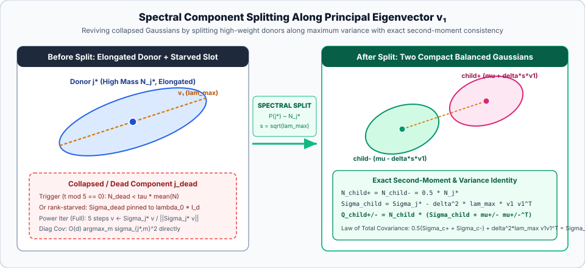

# 05. Spectral Component Splitting & Dual Finalization Strategies

Two design choices make `e-GMM` both **collapse-proof** and **competitive on held-out Test NLL**: (1) **spectral donor splitting** along $\mathbf{v}_1$ to revive dead Gaussians, and (2) **zero-overhead dual finalization** (`Last-Epoch EM` vs. `Slow-EMA`).

---

## 1. Spectral Component Splitting (Reviving Collapsed Gaussians)

### Step 1: Detecting Collapsed / Starved Components
Every `split_interval` batches (default: every **5** batches, matching `e-means` Algorithm 1):
$$
\text{Dead Condition: } N_j < \tau \cdot \bar{N}, \qquad \bar{N} = \frac{1}{k} \sum_{\ell=1}^{k} N_\ell, \qquad \tau = 0.1
$$
*(Components on cooldown from a recent split are excluded until `cooldown` steps elapse.)*

### Step 2: Selecting a High-Weight Donor $j^*$
Sample donor components **without replacement** from healthy components ($N_\ell > \bar{N}$) with probability proportional to their decayed count (or product of count & max eigenvalue):
$$
P(\text{donor} = j^*) \propto N_{j^*}
$$

### Step 3: Finding the Principal Eigenvector $\mathbf{v}_1$ of $\Sigma_{j^*}$
Why not use `e-means`'s alternating hyperplane $\odot [1 \pm \delta, \dots]$?
In `e-means`, all clusters are spherical ($\Sigma = \sigma^2 I$), so any hyperplane cuts the Voronoi cell roughly in half. In a GMM, an overloaded donor $j^*$ covering two sub-clusters is **strongly elongated along its principal covariance eigenvector $\mathbf{v}_1$** (largest eigenvalue $\lambda_{\max}$)! Splitting along $\mathbf{v}_1$ directly cuts the mixture along its axis of maximum variance, maximizing log-likelihood gain:

- **Diagonal Covariance (`cov_type="diag"`)**: Exact principal eigenpair in **$O(d)$** time!
  $$
  m^* = \arg\max_{m \in \{1,\dots,d\}} \Sigma_{j^*, mm}, \qquad \lambda_{\max} = \Sigma_{j^*, m^* m^*}, \qquad \mathbf{v}_1 = \mathbf{e}_{m^*}
  $$
- **Low-Rank + Diagonal (`cov_type="low_rank_diag"`)**: 5 steps of power iteration using matrix-vector products $\Sigma_{j^*} \mathbf{v} = D_{j^*} \mathbf{v} + U_{j^*}(U_{j^*}^\top \mathbf{v})$ in **$O(dr)$** time!
- **Full Covariance (`cov_type="full"`)**: 5 steps of power iteration $\mathbf{v} \leftarrow \Sigma_{j^*} \mathbf{v} / \|\Sigma_{j^*} \mathbf{v}\|_2$ in **$O(d^2)$** time (avoiding $O(d^3)$ `eigh`!).

### Step 4: Mean Displacement & Exact Second-Moment Consistency
Split $\mu_{j^*}$ symmetrically along $\mathbf{v}_1$ with separation factor $\delta \in (0, 1)$ (typically $\delta \approx 0.5$ for spectral mode-splitting, or $\delta \in [0.25, 0.75]$):
$$
\mu_{\text{child}+} = \mu_{j^*} + \delta \sqrt{\lambda_{\max}}\, \mathbf{v}_1, \qquad \mu_{\text{child}-} = \mu_{j^*} - \delta \sqrt{\lambda_{\max}}\, \mathbf{v}_1
$$
By the **Law of Total Covariance**, if a distribution with covariance $\Sigma_{j^*}$ splits equally into two symmetric halves displaced by $\pm \delta \sqrt{\lambda_{\max}}\, \mathbf{v}_1$, the variance **along $\mathbf{v}_1$** shrinks by $\delta^2 \lambda_{\max}$:
$$
\Sigma_{\text{child}} = \Sigma_{j^*} - \delta^2 \lambda_{\max} \mathbf{v}_1 \mathbf{v}_1^\top
$$
*(clamped at $\lambda_0$ along $\mathbf{v}_1$ so $\Sigma_{\text{child}} \succeq \lambda_0 I_d$)*. Notice that the combined mixture variance is conserved:
$$
\frac{1}{2}(\Sigma_{\text{child}} + \Sigma_{\text{child}}) + \frac{1}{2}\big(\mu_+ - \mu_{j^*}\big)\big(\mu_+ - \mu_{j^*}\big)^\top + \frac{1}{2}\big(\mu_- - \mu_{j^*}\big)\big(\mu_- - \mu_{j^*}\big)^\top = \Sigma_{j^*}!
$$
Finally, update the 3-tuple $(N, S, Q)$ consistently so the very next `readout()` returns exact child parameters:
$$
N_{\text{child}\pm} = \frac{N_{j^*}}{2}, \qquad S_{\text{child}\pm} = N_{\text{child}\pm} \, \mu_{\text{child}\pm}
$$
$$
Q_{\text{child}\pm} = N_{\text{child}\pm} \big( \Sigma_{\text{child}} + \mu_{\text{child}\pm} \mu_{\text{child}\pm}^\top \big)
$$
*(And mirror the exact same split onto the passive Slow-EMA shadow accumulators if enabled!)*

---

## 2. Dual Finalization: Last-Epoch Exact EM vs. Slow-EMA Shadow

Just as `e-means` (Section 3.2 & Appendix I) separates **Train MSE** finalization from **Test MSE** generalization, `e-GMM` supports two zero-extra-E-step finalizers:

1. **Last-Epoch Exact EM (`last_epoch`)**:
   During the final epoch $t \in \text{Epoch } T$, accumulate the unweighted sums $(N_j^{\text{last}}, S_j^{\text{last}}, Q_j^{\text{last}})$ from the already-computed responsibilities $r_{ij}$. At the end of epoch $T$, read out:
   $$
   \pi_j = \frac{N_j^{\text{last}}}{\sum_\ell N_\ell^{\text{last}}}, \qquad \mu_j = \frac{S_j^{\text{last}}}{N_j^{\text{last}}}, \qquad \Sigma_j = \frac{Q_j^{\text{last}}}{N_j^{\text{last}}} - \mu_j \mu_j^\top + \lambda_0 I_d
   $$
   - **Property**: Exact EM M-step over the entire dataset with the final E-step assignments—provably maximizes training log-likelihood given those final responsibilities!

2. **Slow-EMA Shadow Accumulators (`slow_ema`)**:
   Maintain passive shadow buffers $(N_j^{\text{slow}}, S_j^{\text{slow}}, Q_j^{\text{slow}})$ updated on every batch using a slower constant step size $\alpha_{\text{slow}} < \varepsilon \alpha_0$ (e.g., half-life $h \approx 50$–$200$ batches).
   - **Crucial Rule**: Slow-EMA buffers **never drive E-step responsibilities during training**; they passively observe $r_{ij}$ and mirror donor splits.
   - **Property**: Acts as Polyak/weight averaging over late batches, reducing finite-sample variance overfitting (especially when $n/k$ is small or $d$ is large) and yielding **lower held-out Test NLL**!

---

## 3. Sources & References
- **Bessa et al. (2026)**: *e-means* (`arXiv:2611.09501`, Sections 3.1–3.2, Appendices H–I).
- **Zhang, Chen, et al. (2003)**: Split-and-Merge EM (SMEM) for Gaussian mixtures (spectral split motivation, without EMA scaling laws).
- **Polyak & Juditsky (1992)**: Acceleration of stochastic approximation by averaging.
